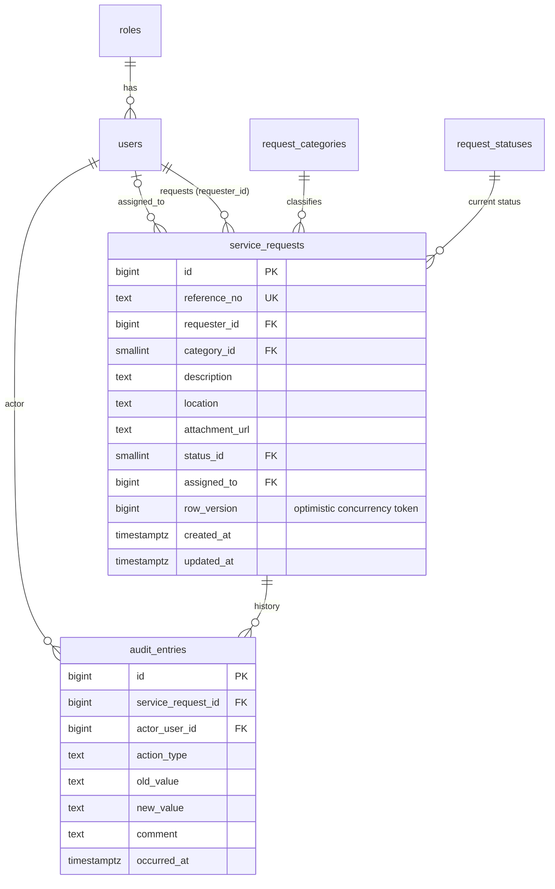

# Initial data model (PED v2.0 - data & persistence baseline)

Source of truth: `src/db/migrations/001_initial_schema.sql` and `002_audit_permissions.sql`. Decision record: ADR-001.

| Concern | Decision |
|---|---|
| Ownership | `service_requests` is the aggregate root; `audit_entries` are owned by a request and never edited |
| Controlled values (NFR-006) | Categories, statuses, roles are reference tables with FKs; audit `action_type` has a CHECK |
| Integrity (NFR-005) | FKs on every audit link; app role has SELECT/INSERT only on `audit_entries`; guard trigger refuses UPDATE/DELETE |
| Concurrency | `row_version` compared in the UPDATE predicate (ADR-001) |
| Reference numbers (FR-001) | Sequence-backed `CC-YYYY-NNNNNN`, unique |
| Growth | Indexes on requester, status, assignee, audit by request. Neon Free 0.5 GB is ample for this scale (ADR-003) |
| SPOF / availability | Single Neon instance is a SPOF at this scale; accepted (NFR-002 target 99% business hours); mitigation = docker-compose fallback + manual `pg_dump` before assessments |
| Known gaps | `password_hash` algorithm pending auth ADR; comments (FR-011) reuse `audit_entries` (`COMMENT_ADDED`) - confirm or split into a table at M3; attachments stored externally (URL only) |
