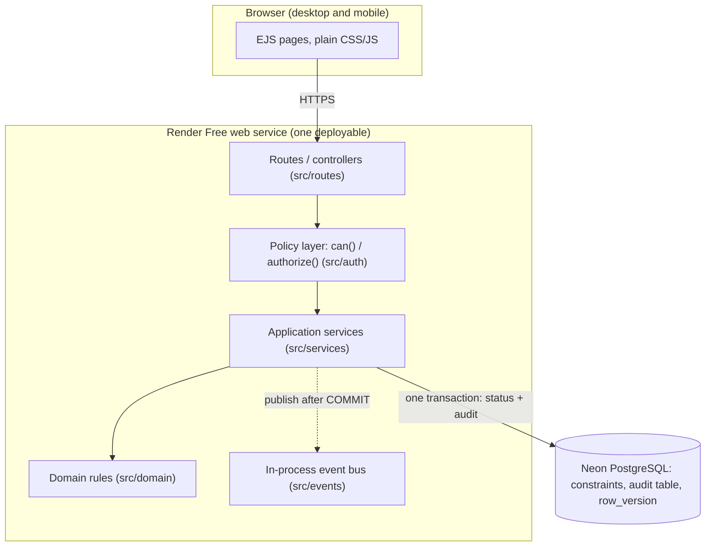

# ADR-004: Architecture style and architecturally significant requirements (ASRs)

| Field | Value |
|---|---|
| Status | Proposed - M2 baseline |
| Date | 2026-09-30 |
| Deciders | Thato Goqo (Technical Lead for M2), Daluvuyo Magagane |
| Related | ADR-001, ADR-002, ADR-003; M1 constraints (scope, schedule, cost, quality, security); RSK-001, RSK-003 |

## 1. ASRs (the requirements that actually shape the architecture)
| ASR | Source | Measurable expectation | Architectural consequence |
|---|---|---|---|
| ASR-1 Data integrity and auditability | FR-010, NFR-005, NFR-006 | 100% of status changes have a matching audit row; invalid transitions rejected (400) | One transactional boundary around a state change and its audit entry; relational store with constraints (ADR-001) |
| ASR-2 Access control | FR-015, NFR-004 | Direct URL access to another role's function returns 403 | One central policy layer, enforced server-side (ADR-005) |
| ASR-3 Cost and free-tier fit | NFR-009, RSK-001 | Zero infrastructure spend; runs on Render Free + Neon Free | Single deployable service, no message broker, no extra infrastructure (ADR-003) |
| ASR-4 Availability and responsiveness | NFR-002, NFR-003 | >= 99% in business hours; <= 2 s on warm, non-peak load | Stateless web tier, health probe, offline fallback; cold-start exception recorded |
| ASR-5 Buildable by two people | Schedule constraint, RSK-003, NFR-007 | Whole system explainable and defensible by both members | Few moving parts; one language; simple module boundaries |

Deliberately not listed: performance at scale, multi-tenancy, mobile push (out of scope in M1).

## 2. Alternatives considered
| Option | For | Against | Verdict |
|---|---|---|---|
| **A. Layered modular monolith**, server-rendered, one web service + one database | Meets ASR-3 and ASR-5; transactions are trivial in one process; one CI pipeline | Modules could blur if boundaries are not enforced by review | **Chosen** |
| B. Separate SPA + REST API | Cleaner front/back split | Two deployables, CORS, token handling, double the free-tier surface and testing; no requirement needs it | Rejected |
| C. Microservices (requests, audit, notifications) | Independent scaling | Network boundary for a status change (Deutsch, 1994), distributed consistency for audit, several services on free tier, far beyond team capacity | Rejected: complexity is not justified by any ASR |

## 3. Decision
A **layered modular monolith** deployed as one Node.js web service backed by one PostgreSQL database.

**Logical layers vs physical tiers.** There are five *logical* layers (routes, policy, services, domain, data access) but only two *physical* tiers: the web service and the database. The layers are folders and rules about who may call whom, not separate deployments.

Dependency rule: routes -> policy -> services -> domain; services -> database. The domain layer imports nothing outside itself, which is what makes the transition rules unit-testable without a database.

## 4. Consequences
- **Benefits:** meets the free-tier and capability constraints; one transaction covers a state change and its audit; simple local run, CI and demo.
- **Costs:** the web tier is a single instance (no horizontal scaling and a single point of failure), and the database is a single point of failure too. Both are accepted at this scale (ASR-4) with the docker-compose fallback and a manual `pg_dump` before assessments.
- **Revisit triggers:** a real external consumer of events, a measured performance problem, or a requirement for offline or native clients.

## 5. If this decision changed
PED architecture section and diagrams; ADR-002, ADR-003, ADR-006; RTM component column for every requirement; repo structure and CI.
